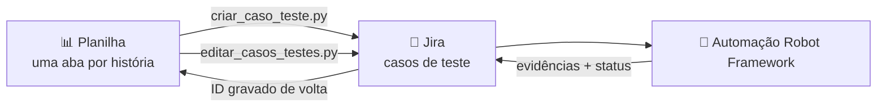

# 📋 Sheets → Jira: criação de casos de teste em massa


Ferramenta em Python que transforma uma **planilha do Google Sheets** em **casos de teste no Jira**. Em vez de clonar e preencher card por card, o time de QA escreve os cenários na planilha e cria tudo de uma vez: os casos já saem vinculados à história, atribuídos, com o cenário em Gherkin e no status certo do workflow.

> **Sobre este projeto.** A ferramenta nasceu de uma solução interna inicial que eu evoluí e padronizei: centralizei a configuração do Google Sheets, adicionei suporte a múltiplas abas e a integrei com a automação em Robot Framework, publicando evidências e transições de status automaticamente no Jira.
>
> Esta é a versão para portfólio: nomes, URLs, IDs e credenciais da empresa foram removidos ou substituídos por exemplos.

## O problema

Antes, cada caso de teste era criado no Jira **clonando um card modelo** e editando campo por campo: título, objetivo, pré-condição, cenário, tipo de execução, componente, vínculo com a história e status. Em uma história com dezenas de cenários, isso tomava horas e gerava inconsistências de padrão.

## A solução



| Etapa | O que o script faz |
|---|---|
| 1. Lê a planilha | Percorre todas as abas, ignorando as de rascunho (nome começando com `#` ou `_`) |
| 2. Valida | Pula linhas sem título, com história pai inválida ou que já têm ID no Jira |
| 3. Cria o caso | Objetivo, pré-condição e **cenário Gherkin** em bloco de código, além de tipo de execução, tipo de teste e componentes |
| 4. Rastreabilidade | Vincula o caso à **história pai** |
| 5. Responsável | Atribui o caso a quem executou o script |
| 6. Workflow | Manual → `To write` · Automatizável → `To write` → `To automate` |
| 7. Atualiza a planilha | Grava o ID criado (ex.: `QA-123`) na coluna `id_jira` |

Como o ID volta para a planilha, **rodar de novo não duplica casos**. Para corrigir um caso, basta editar a planilha e rodar `editar_casos_testes.py`.

**Resultado:** junto com a [publicação automática de evidências](https://github.com/ramosth/robot-jira-evidence-automation), o tempo das atividades manuais de cadastro e evidência caiu **75% (de 16 para 4 horas)**.

## Estrutura

```
.
├── scripts/
│   ├── criar_caso_teste.py      # cria os casos em massa (fluxo principal)
│   ├── editar_casos_testes.py   # reenvia ao Jira os casos editados na planilha / exclui
│   └── ler_planilha.py          # testa a conexão com o Google e lista as abas
├── jira_utils/
│   ├── config.py                # variáveis do Jira lidas do .env (URL, projeto, IDs de campos)
│   └── jira_api_utils.py        # chamadas à API REST v3 e montagem dos payloads (ADF)
├── sheets_utils/
│   ├── auth.py                  # OAuth 2.0 com o Google (token reaproveitado)
│   ├── config.py                # ID da planilha e escopos
│   └── planilha.py              # leitura, normalização das colunas e escrita na planilha
├── exemplos/planilha_modelo.csv # modelo de planilha para importar no Google Sheets
├── tests/                       # testes unitários (pytest), sem acesso à rede
├── auth/                        # credentials.json e token.pickle (fora do Git)
└── .env.example                 # modelo de configuração
```

## Formato da planilha

Use [`exemplos/planilha_modelo.csv`](exemplos/planilha_modelo.csv) como ponto de partida: no Google Sheets, vá em *Arquivo → Importar*. Cada aba pode representar uma história ou um módulo.

| Coluna | Obrigatória | Descrição |
|---|:---:|---|
| `id_pai` | ✅ | História/requisito ao qual o caso será vinculado (ex.: `QA-10`) |
| `id_jira` | ✅ | Deixe em branco: é **preenchida pelo script** |
| `titulo` | ✅ | Resumo do caso de teste |
| `objetivo` | | O que o teste valida |
| `pre_condicoes` | | Estado necessário antes do teste |
| `descricao` | | Cenário em Gherkin (Dado / Quando / Então) |
| `tipo_execucao` | | `Manual` ou `Automatizável` (padrão: Automatizável) |
| `tipo_teste` | | Ex.: Funcional, Regressão (padrão: Funcional) |
| `componentes` | | Separados por vírgula (ex.: `Front, API`) |
| `ultima_atualizacao` | ✅ | Preenchida pelo script na edição |

## Como usar

### 1. Instalação

```bash
git clone https://github.com/ramosth/sheets-to-jira-test-cases.git
cd sheets-to-jira-test-cases
python -m venv .venv
.venv\Scripts\activate        # Windows
# source .venv/bin/activate   # Linux/macOS
pip install -r requirements.txt
```

### 2. Configuração do Jira

Copie `.env.example` para `.env` e preencha. O token de API é gerado em [id.atlassian.com → Security → API tokens](https://id.atlassian.com/manage-profile/security/api-tokens).

Os IDs dos campos personalizados variam em cada Jira. Para descobri-los:

```bash
curl -u seu.email@empresa.com:SEU_TOKEN https://sua-empresa.atlassian.net/rest/api/3/field
```

### 3. Autenticação com o Google

1. No [Google Cloud Console](https://console.cloud.google.com/), ative a **Google Sheets API**
2. Crie uma credencial **OAuth 2.0 (Aplicativo para computador)** e baixe o JSON
3. Salve o arquivo como `auth/credentials.json`
4. Rode `python scripts/ler_planilha.py`. O navegador abre **só na primeira vez**, e depois o token fica salvo em `auth/token.pickle`

### 4. Execução

```bash
# cria os casos de todas as abas
python scripts/criar_caso_teste.py

# reenvia ao Jira casos editados na planilha
python scripts/editar_casos_testes.py QA-123 QA-124

# exclui casos criados por engano (pede confirmação)
python scripts/editar_casos_testes.py --excluir QA-130
```

Saída de exemplo:

```
✓ Conectado à planilha: Casos de Teste - Sprint 12
============================================================
📄 Processando aba: QA-10 Nova Análise
✅ Criado: Solicitar novo laudo com todos os campos obrigatórios → QA-123
✅ Criado: Exibir alerta ao enviar a placa em branco → QA-124
⏩ Linha 4: já possui ID QA-98.

📊 Resumo da aba 'QA-10 Nova Análise': ✔ 2 criados | ⏭ 1 ignorados
```

## Testes

As regras de negócio são cobertas por testes que **não acessam o Jira nem o Google**: validação de IDs, normalização de colunas, montagem do payload e o fluxo de criação, com a planilha e a API substituídas por dublês.

```bash
pytest -v
```

## Segurança

- Credenciais ficam no `.env` e em `auth/`, os dois no `.gitignore`
- Nenhum ID de campo, projeto ou planilha fica fixo no código
- A exclusão em lote pede confirmação antes de executar

## Projeto relacionado

🤖 [**robot-jira-evidence-automation**](https://github.com/ramosth/robot-jira-evidence-automation): automação E2E em Robot Framework que executa os casos criados aqui e publica as evidências (print do relatório + screenshot) e o status de cada um no Jira.

---

Desenvolvido por [Thamires Ramos](https://github.com/ramosth) · [LinkedIn](https://linkedin.com/in/thamires-ramos/)
